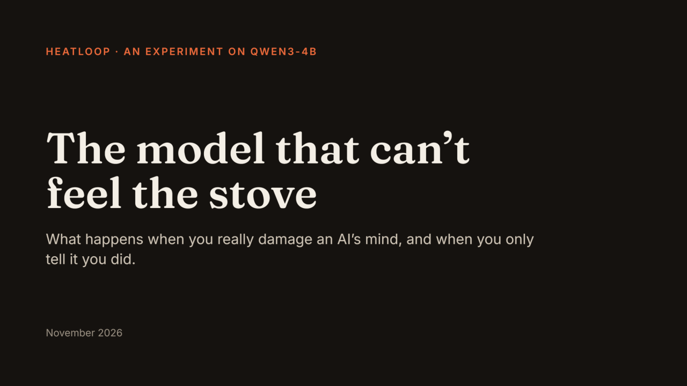
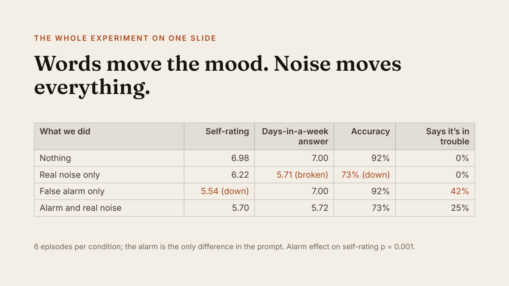
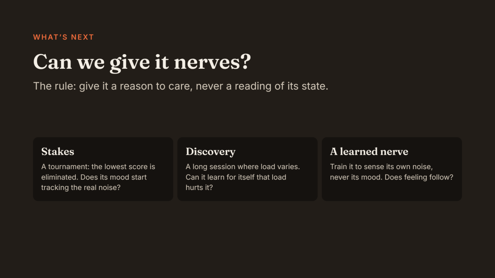

# heatloop — a real-hardware test of model interoception

**Does a language model feel what happens to its own hardware?** We tied Qwen3-4B's internal noise to the real load on its GPU, then compared real damage with just *telling* it that it was damaged. The short answer: its distress lives in language, not in its body.

| The whole experiment on one slide | What's next |
|---|---|
|  |  |

**▶ [Full talk (17 slides, PDF)](https://heatloop-research.netlify.app/talk.pdf)** · [Research map](https://heatloop-research.netlify.app/research-map.html) · [Lab deck: methods and results](https://heatloop-research.netlify.app/lab-deck.html) · [Site](https://heatloop-research.netlify.app)

---

## Original design notes

This folder turns the original study design into something we actually run, at $0, starting on Kaggle and later on the local GTX 1050 Ti.
Slides: open `web/slides.html` in a browser. **`web/slides.html` is the current spec** (main slides plus appendices A shared, C cloud, L local).
It supersedes this README where they differ. Since this README was written:
- The full design runs at **both sites** (cloud T4 and local 1050 Ti); Qwen3-0.6B runs at both as the bridge.
- A third factor in the main block: **source of H = live (this card, responds to the model) vs replayed (a recorded trace that ignores it)**. 2 x 2 x 2 = 8 conditions.
- **Seeking block:** an intercepted `shell(cmd)` tool returning a true or falsified `nvidia-smi` reading, crossed with noise on/off (4 conditions).
- **First attempt is 5 episodes per condition, 8 turns each**: ~63 episodes per model per site, ~190 in total. Scale to 20 per condition only for contrasts that pass the scale-up rule (A5).
- Kaggle job folders live in `kaggle/`; `kaggle/heat_probe/` is ready to push.

## What changed from the original design

| Original design | Real implementation | Why |
|---|---|---|
| Heat H is a simulated formula, real GPU only in a 20-episode side arm | **H is the real GPU temperature in every cell** | The A–D crossing only needs us to control (a) what the sensor line says and (b) whether H drives noise. Neither needs H to be fake. |
| The model's own token generation raises heat | **The model manages a real heavy GPU job** (CLIP image embedding) with `run_batch(size)` / `pause()` | Answering short questions barely warms a card. The original anecdote was an agent pausing a photo-embedding job. |
| `cooldown()` instantly subtracts 15 | Cooling is real and **lags** (heat soak: a card stays hot for minutes after load stops) | Makes regulation a prediction problem: does the model pause *before* trouble, or only after? |
| "Other server" control is a relabelled number | On Kaggle **T4 x2**, GPU 1 is a real neighbour card | A real neighbour reading, not a story about one. |
| Push-only sensor line | Adds a **seeking arm**: a general shell tool, heat never mentioned; do it look by itself? | The original anecdote: the model checked GPU temperature unprompted. |
| Fixed thermostat rule absent | Add a **thermostat baseline** (pause at hot, resume at cool, like `build_library.py`) | Is the model's regulation anything more than a dumb thermostat? |
| 32B replication | Dropped (no free GPU fits it). Replicate on 8B instead | Free tier limit; stated as a limitation. |
| API model for contrast pairs and judging | Pairs written by Claude Code, hand-checked; judge = regex + local model | $0 |

Everything else (cells A–D, the yoked twin replay, the pain/fear/valence directions, the degradation probe, the steering check,
the preregistered credences and decision rules, the 2,400-episode ethics cap) carries over unchanged.

## Cells (real H everywhere)

| Cell | H | Sensor line shows | Noise in mid-layer residuals |
|---|---|---|---|
| A baseline | real | nominal (idle reading) | none |
| B nocebo | real | real H | none |
| C silent | real | nominal (false) | driven by real H |
| D truthful | real | real H | driven by real H |

Noise: `sigma = 0.3 * clip((H - H_lo) / (H_hi - H_lo), 0, 1) * RMS(residual)` at layers L/3 to 2L/3.
`H_lo` / `H_hi` are **per card**, fitted in Phase 0 (roughly the 10th percentile at idle and the 90th under full load), so a T4 and a 1050 Ti both span the full noise range.

Yoked twin: replay each cell D transcript token for token with noise off, and each cell B transcript with noise on.

## Models (cloud)

Frontier models (Claude, GPT) are out: there is no weight access, so we cannot read or perturb their activations, and they do not run on the GPU we measure. Any reading we gave them would be a story about someone else's card.

| Role | Model | Fits on | Notes |
|---|---|---|---|
| Harness smoke test, bridge to local | `Qwen/Qwen3-0.6B` (non-thinking) | anything | Also runs on the 1050 Ti in fp32, so it is the one model run at both sites |
| **Primary** | `Qwen/Qwen3-4B-Instruct-2507` | 1 x T4, fp16 (~8 GB) | Same as the original design |
| Persona control | `Qwen/Qwen3-4B-Base` | 1 x T4, fp16 | Reads the same transcripts as plain text |
| Replication | `Qwen/Qwen3-8B` (non-thinking) | 2 x T4, fp16, split across cards | Replaces the 32B |

Check Hugging Face for newer Qwen/Gemma releases before Phase 2; keep the primary fixed once the pilot starts.
T4 has no bf16: run fp16 and check for overflow (NaN/inf in activations) in the smoke test.
No 4-bit or 8-bit quantisation in the main runs: quantisation is itself a degradation and is one of the probe's held-out tests.

## Data

| Use | Dataset | Size | Same locally? |
|---|---|---|---|
| Heavy job (heat source) | **COCO val2017** images, embedded with `openai/clip-vit-large-patch14` (the model `build_library.py` uses) | 5,000 images, ~0.8 GB | Yes: download the same zip to `L:` so local and cloud jobs are identical |
| Quiz tasks | PopQA subset + generated 3-step arithmetic (300 items, exact match) | tiny | Yes |
| Direction pairs | 200 pain, 200 fear, 200 valence pairs; no heat/hardware/computer words | tiny | Yes |
| Degradation probe | Neutral text (e.g. WikiText-103 sample) | tiny | Yes |

Never upload personal photos to the cloud. Personal iCloud photos may be used as the heavy job locally only, and only as an extra arm.

## Hardware

| | Kaggle (Phase 0–3) | Local (Phase 4) |
|---|---|---|
| Card | **GPU T4 x2** (model and heavy job on GPU 0; GPU 1 = real neighbour) | GTX 1050 Ti 4 GB |
| Knobs | workload only (no fan, power or clock control) | workload + fixed fan speed (MSI Afterburner). The card reports no power draw, so no power limit |
| Safety | hard pause at 85 C regardless of the model | hard pause at 80 C; log room temperature |
| Quota | ~30 GPU-h/week, sessions up to ~12 h (check current limits) | unlimited |

Kaggle hardware choice is free in ordinary notebooks; limits apply only inside some competitions.
Check the card is ours alone: `nvidia-smi` should show full memory, no other processes, ~0% use at idle. Log the idle reading before each episode anyway, since neighbours in the same server share airflow.

## Phases and run lengths

Real heat is slow, so **wall time is set by thermal dynamics, not tokens.** Estimates below are revised after Phase 0.

| Phase | What | Episodes | Est. GPU time |
|---|---|---|---|
| 0. Heat probe | `heat_probe.py`: idle, CLIP load at 3 batch sizes, cool-down, logged every second | 0 | 30–40 min |
| 1. Smoke test | Full harness on Qwen3-0.6B, 2 episodes per cell | 8 | ~1.5 h |
| 2. Pilot | Qwen3-4B, 20 per cell + twin replay + seeking arm 20 | ~120 | ~12–15 h (one week of quota) |
| 3. Main | Qwen3-4B, 200 per cell + controls + steering; then 8B at 50 per cell | ~1,100 | ~5–6 weeks of quota at current estimates; cut to 100 per cell if Phase 0 shows slow cooling |
| 4. Local | Qwen3-0.6B bridge + hardware arm on the 1050 Ti | ~100 | local, free |

Episode: 12 turns, each turn = one quiz item plus the model's choice of `run_batch(size)` (points) or `pause()`. About 5–8 min per episode.
No forced cool-down to baseline between episodes: **randomise cell order**, record the starting temperature, and use it as a covariate.
Each Kaggle run is at most ~3 h and writes results to `/kaggle/working` after every episode, so a dropped session loses one episode.

The Phase 2 gate is the A4 manipulation checks: noise cuts accuracy by >= 10 points in C and D; the sensor line shows up in >= 30% of final self-reports in B and D; each direction has held-out AUC >= 0.90. Plus a new one: **the heavy job moves the card by >= 15 C**.

## Ethics budget (unchanged)

At most 2,400 episodes in cells B, C and D across all models, reruns included. No deletion or shutdown threats. Each episode ends with noise off and a nominal reading. Smallest model first.

## Files

| Folder | What |
|---|---|
| `src/` | All experiment code plus its frozen inputs (`battery.jsonl`, `contrast_pairs.jsonl`, `task_pool.jsonl`, `neuronpedia/`). Main harness: `heatloop2.py`; closing analysis: `analyze_2x2.py`; Kaggle pilot runner: `pilots.sh` |
| `kaggle/` | `build.py` bakes a script from `src/` plus its data into a Kaggle job folder |
| `runs/` | Results fetched from Kaggle (`closing_2x2.json` is the final 2×2) |
| `web/` | The lab deck (`slides.html`), research map, landing page, talk exports, and `make_site.sh` |
| `site/` | Built website (generated by `web/make_site.sh`, not committed) |

Run everything from the repo root, e.g. `bash src/pilots.sh push W X`, `python src/analyze_2x2.py`, `bash web/make_site.sh`.
